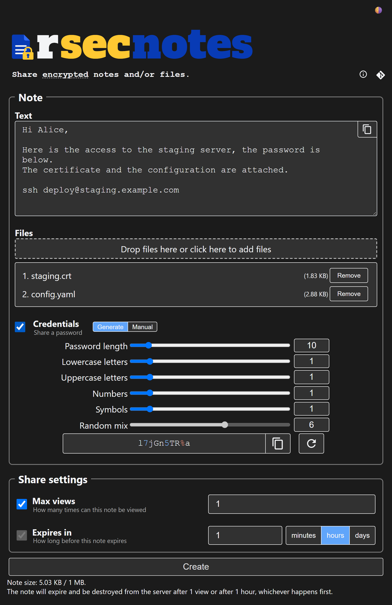
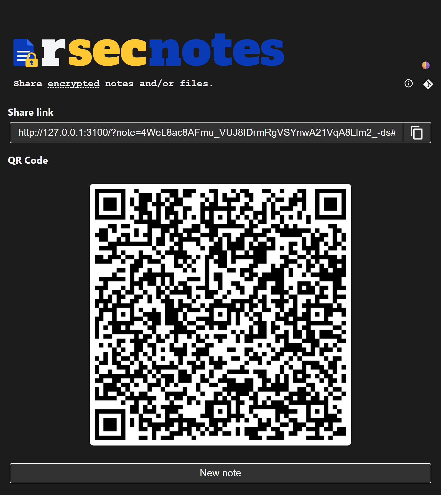
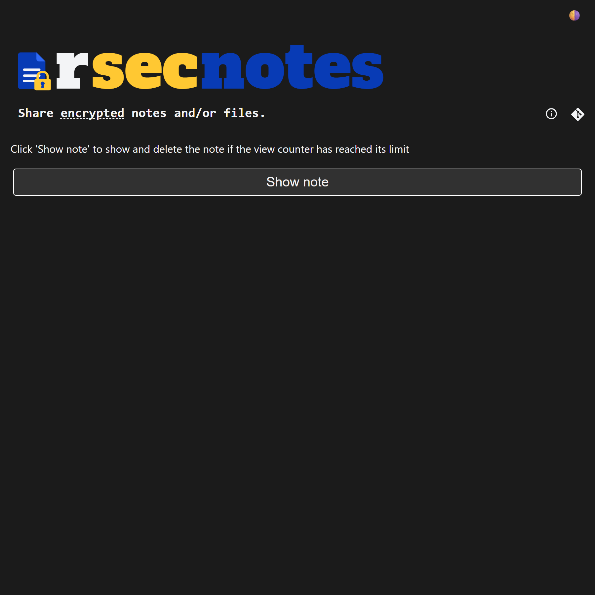
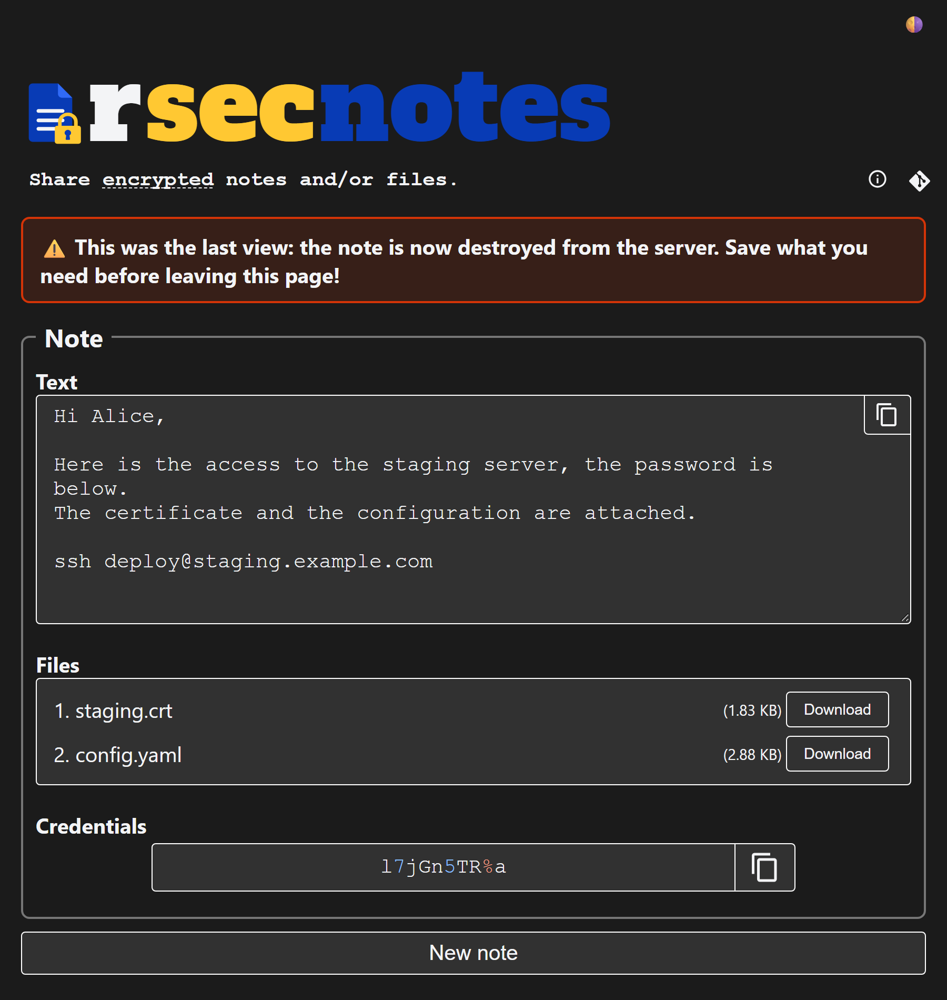

<h1></h1>

Share notes, files and credentials through a link. They are encrypted in your browser before being sent. Inspired by [cryptgeon](https://github.com/cupcakearmy/cryptgeon).

| Create | Share | Open | Read |
| :-: | :-: | :-: | :-: |
|  |  |  |  |

## Features

- Notes are encrypted and decrypted by the browser with AES-256-GCM (Web Crypto API), the key is in the link fragment and never reaches the server
- Share link with QR code, drag & drop files, light and dark themes, optional logo
- A note can contain a text, credentials (a generated or typed password) and multiple files
- Notes are destroyed after a number of views and/or a duration
- Notes are padded before encryption, so the server only knows their approximate size
- Notes are stored in memory, or on disk encrypted again with a key only kept in memory, and the oldest notes are dropped when space is needed
- Per client rate limiting of notes creation
- Optional TOTP code (authenticator app) required to create large notes
- Single binary server
- Client side can be audited: no minification, no dependencies besides a QR code generator, kept simple
- Translated in English and French

## Getting Started

Generate a configuration file, edit it, then run the server:

```sh
rsecnotes generate-config --config config.toml
rsecnotes run --config config.toml
```

```
Usage: rsecnotes <COMMAND>

Commands:
  generate-config  Generate a default configuration file
  run              Run the server
  generate-totp    Generate a TOTP secret, required to create large notes (see `[server_settings.totp]`)
  help             Print this message or the help of the given subcommand(s)
```

The configuration is a TOML file, see [config.example.toml](src/config.example.toml) for every option.

## Contributing

Contributions are welcome! Please open issues or submit pull requests.

### How to build

The client is written in TypeScript and compiled by `build.rs`, which needs Node.js:

```sh
npm install
cargo build --release
```

### How to iterate

```sh
cargo install cargo-watch --locked
cargo watch -x "run -- run --config ./src/config.example.toml"
```

### How to test

```sh
cargo test
npx playwright install
npm test
```

`npm test` runs the [Playwright](https://playwright.dev) end-to-end tests of [e2e/](e2e/) in Chromium, Firefox and WebKit, against a server started with [e2e/config.toml](e2e/config.toml). They check that notes can be read, then are destroyed. They also check that the key and the plaintext are never sent to the server, and that the page has no CSP violations.

## Internals

### Note link

```
https://host/?note=NOTE_ID#KEY
```

`NOTE_ID` is a server generated random 256-bit value, `KEY` the browser generated ([`crypto.subtle.generateKey`](https://developer.mozilla.org/en-US/docs/Web/API/SubtleCrypto/generateKey)) AES-256-GCM key, both in base64url without padding. The key is in the [fragment](https://developer.mozilla.org/en-US/docs/Web/URI/Reference/Fragment), which browsers never send to the server.

### Encapsulation format

```
encrypted_data =
    VERSION_1: u8
    IV: [u8; 12]
    crypto.subtle.encrypt(decrypted_data): [u8; _] (including the 16 bytes GCM tag)
```

The first byte is the version and must be `1`, as only one version is supported.
The next 12 bytes are the random AES-256-GCM initialization vector (nonce).
The remaining bytes are the result of [`crypto.subtle.encrypt`](https://developer.mozilla.org/en-US/docs/Web/API/SubtleCrypto/encrypt) with `{ name: "AES-GCM", iv }` as [`AesGcmParams`](https://developer.mozilla.org/en-US/docs/Web/API/AesGcmParams).

```
decrypted_data =
    TEXT_LEN: u32le
    TEXT: [u8; TEXT_LEN]
    PWD_LEN: u32le
    PWD: [u8; PWD_LEN]
    FILES_LEN: u32le
    FILES: [FILE; FILES_LEN]
    PADDING: [0u8; _]
FILE =
    NAME_LEN: u32le
    NAME: [u8; NAME_LEN]
    SIZE: u64le
    DATA: [u8; SIZE]
```

Strings are UTF-8. The padding is zeros up to 128 bytes, then the next power of two up to 1024 bytes, then [Padmé](https://lbarman.ch/blog/padme/) (at most ~12% overhead), reduced if needed to fit the server maximum note size.

### Server storage

Notes are kept in memory, unless their slot has a `directory`. They are then stored on disk, encrypted with XChaCha20-Poly1305 by a key generated at startup and only kept in memory, so they are unreadable once the server stops. At startup, any remaining notes on disk are removed.

## License

This project is licensed under the MIT License.
